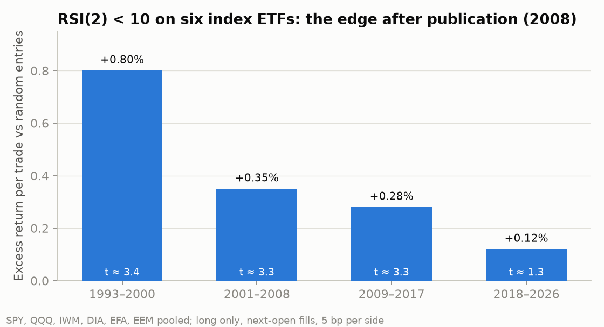

# Marcelo Renere: investment research

Ingeniería Comercial and MSc in Finance (Universidad Adolfo Ibáñez) · Master in Big Data & Data Science (Universidad Complutense de Madrid) · Master in Finance (EAE Business School) · CFA Level I candidate

I studied finance twice and data science once, and this repository is where the two meet. It's the research I do on my own time: company valuations, the equity screener I run every week, an SQL project on SEC filings, factor and risk analysis, and a long list of systematic strategies I tested properly.

Most of those strategies failed. I kept them because how I tested them, and why I rejected them, says more about how I work than a single winning backtest would. The [synthesis](SYNTHESIS.md) is the two-minute version.

## Company valuations

[`equity-research/`](equity-research/pitches) has the pitches and [`valuation/`](valuation) the models behind them. Each pitch follows the same template: thesis, bull and bear case, valuation, catalysts and what would make me wrong. I update them after each set of results instead of rewriting them, so you can see what I thought at the time.

- Micron ([pitch](equity-research/pitches/MU_pitch.md)): a three-scenario DCF built from SEC data at the top of the memory cycle. My base case is $511 against a price of $879. The reverse DCF needs a 94% operating margin from FY29 on. That margin is impossible, so what the price really assumes is that revenue never falls back.
- GTT ([pitch](equity-research/pitches/GTT_pitch.md)): the near-monopoly in LNG carrier tanks. Revenue is built from the order book plus future orders times the royalty per ship. The price needs about 93 orders a year, while management's own estimate is about 60. Updated after the Q3 2026 activity update.
- JPMorgan ([pitch](equity-research/pitches/JPM_pitch.md)): justified P/TBV and a residual income model. At about 3x tangible book, the price assumes a 22–23% return on tangible equity forever. Updated after the Q3 2026 results.

The Excel models are generated by Python and have live formulas, a reverse DCF and sensitivity tables. On top of them, a Monte Carlo runs 20,000 DCFs per company to give a distribution of value instead of three points. The Python and Excel versions are tested against each other.

## Equity screener

[`equity-screener/`](equity-screener) is a five-factor screen (P/E, ROE, D/E, FCF yield, PEG) over US and European stocks.

- It validates the data before scoring, keeps a history of each run and sends the results to Telegram.
- It has a point-in-time US backtest for 2012–2026, rebuilt from first-reported SEC XBRL filings so it only uses numbers that were public at the time. I calibrated it against TradingView and checked it for survivorship bias.
- A weight-robustness study checks whether the result depends on how the five factors are weighted.

The honest result: the top 10 beat the equal-weight universe by about 3% a year, with a t-stat around 1. That's not enough to call it an edge. The folder README has the full numbers and the caveats.

## SQL on SEC filings

[`sql-analysis/`](sql-analysis) loads 10.4 million XBRL facts from 20,000 SEC filers into DuckDB, keeping every version of every number with the date it was filed. Then it asks five questions, one SQL file each:

- Which sectors have the highest and most cyclical margins?
- How often do companies change an annual number after filing it? About one in 14 re-present a past year's revenue, almost always downwards, usually after selling a business. That's why the screener backtest uses first-reported numbers.
- Did companies that shrank their share count do better? The median buyback stock returned +55% over 2021–25, against +22–35% for the rest.
- Do high-ROE companies stay high-ROE? 53% of the top quintile are still there three years later.
- How fast do companies file their 10-K, and what that means for point-in-time data.

The SQL uses CTEs, window functions (`ROW_NUMBER`, `NTILE`), conditional aggregation to pivot tags into columns, and self-joins across years.

## Factor models and portfolio risk

[`research/factor-models`](research/factor-models) regresses my backtested portfolios on the Fama-French five factors plus momentum, to see whether the screener's 3% a year is skill or factor exposure. It's mostly a profitability tilt (RMW loading 0.68) plus small-cap value, and what's left is about 3% a year with a t-stat around 1. My [momentum backtest](research/momentum) turned out to be the published momentum factor: 89% of it is explained by French's series, which is a good check on the code and a reminder that it's not a discovery.

[`research/portfolio-risk`](research/portfolio-risk) measures the risk of a 70/20/10 equity portfolio the way a risk desk would:

- One-day VaR and CVaR five ways. The normal distribution understates the 99% expected tail loss by about 40%.
- A 21-year backtest of the 99% VaR with Kupiec and Christoffersen tests. Only filtered historical simulation gets the number of exceptions right (55 against 50 expected), and even it fails the clustering test at the start of each crisis.
- Historical stress tests in euros and dollars. In 2022 the dollar halved a euro investor's loss (−10% against −21%).

## Systematic strategies

I tested 11 systematic ideas in 2026, each with the rule and the pass criterion written down first, realistic costs and out-of-sample data. None passed. [SYNTHESIS.md](SYNTHESIS.md) has the scorecard and what I took from it.

- [`strategy-lab/`](strategy-lab): cointegrated pairs (with Kalman and Ornstein-Uhlenbeck variants), an ML direction predictor, commodity trend following, Fed-regime sector rotation and adding quality or trend sleeves to a 70/20/10 portfolio. Most are archived, each with a write-up of why.
- [`research/realised-vol`](research/realised-vol): HAR-RV volatility forecasting and volatility targeting. The forecast is 22% better than a trailing average, and the strategy built on it performs exactly the same.
- [`research/mean-reversion`](research/mean-reversion): short-term RSI(2) reversal on index ETFs, and how its edge has shrunk by about 85% since 2008, when it became widely known.



The pattern across all of them: published edges fade, what still works reduces risk rather than adding return, and an "almost significant" t-stat usually comes from one or two episodes.

## How I test things

1. Write the rule and the pass criterion down before looking at results.
2. Use point-in-time data and walk-forward or out-of-sample periods.
3. Charge realistic costs and compare against a fair benchmark: buy and hold, the equal-weight universe, the same average exposure, or random timing.
4. Report confidence intervals and subperiods, not just the headline number.
5. If it fails, archive it with the evidence instead of tweaking it until it passes.

## Running the code

Python 3.11+.

```
pip install -r equity-screener/requirements.txt -r equity-screener/requirements-backtest.txt
pip install -r valuation/requirements.txt
pip install -r sql-analysis/requirements.txt
pip install -r research/requirements.txt
pip install -r requirements.txt            # strategy-lab
```

Market data is downloaded from Yahoo Finance and SEC EDGAR on the first run and cached locally; it isn't included in the repo. The backtest needs a `SEC_USER_AGENT` in `equity-screener/.env` (see `.env.example`). The SQL project builds its database from the SEC files the backtest downloads. Each folder README has the exact commands.

## Tools

Python (pandas, statsmodels), SQL (DuckDB), Excel models generated with openpyxl, SEC EDGAR, Yahoo Finance and Kenneth French data library data. I use Claude as a coding and writing assistant; the questions, the test designs and the calls on what to keep or drop are mine.

## Disclaimer

Personal research. Nothing here is investment advice, and backtested results don't predict future returns.

## Contact

[LinkedIn](https://www.linkedin.com/in/marcelo-renere/) · mrenere@student.eae.es
