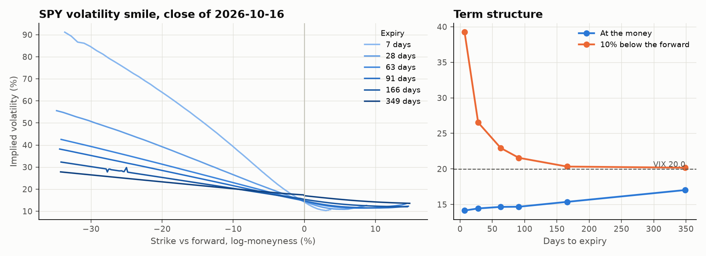
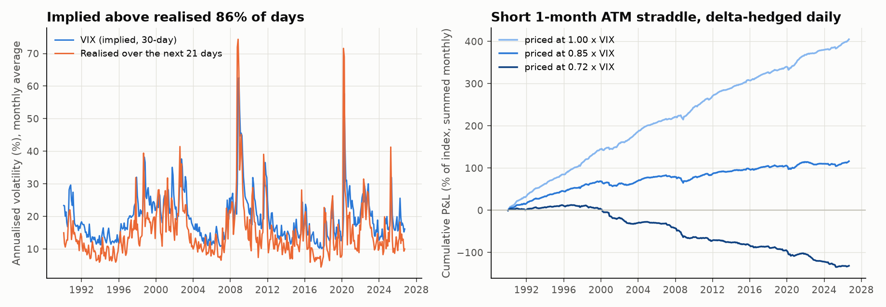

# Derivatives: an option-pricing library, the SPY volatility surface and the variance risk premium

October 2026. Three pieces, from theory to market data. First I wrote the pricers myself and tested them against each other. Then I used them to read today's SPY option market. Finally I tested whether the best-known "free lunch" in options, selling volatility, survives honest assumptions.

## 1. Pricing library (`options.py`, `test_options.py`)

- Black-Scholes: price and Greeks (delta, gamma, vega, theta, rho), with a dividend yield.
- **Implied volatility** by Brent's method.
- **Cox-Ross-Rubinstein binomial tree**, European and American.
- **Monte Carlo** under geometric Brownian motion, with antithetic draws and the terminal stock price as a control variate.

`python -m unittest test_options -v` runs eight checks:

- a textbook value from Hull;
- put-call parity;
- the binomial tree converging to Black-Scholes;
- the American put being worth more than the European one, while an American call on a non-dividend stock isn't;
- Monte Carlo landing within its standard error;
- the control variate cutting that error;
- every Greek matching a finite-difference derivative;
- the implied-vol round trip.

The tests caught a real bug. My first Monte Carlo estimated the control-variate coefficient on individual paths. With antithetic pairs that is wrong: the pairing already removes the linear part, and the coefficient *added* variance instead of removing it. Estimating it on pair averages fixed it. The standard error now drops about 4× (0.025 → 0.006 on a 1-year option).

## 2. The SPY volatility surface (`vol_surface.py`)

Snapshot of the SPY option chain at the close of 2026-10-16: SPY 763.25, VIX 20.0. I used out-of-the-money options only (puts below the forward, calls above), mid prices, and my own implied-vol solver. The forward for each expiry is backed out of put-call parity on near-the-money strikes, F = K + e^{rT}(C − P), instead of assuming a dividend yield. My first version assumed 1.2%, and calls and puts disagreed at the money on the long expiries.



| Days | ATM vol | Vol 10% below the forward | Skew (down − ATM) |
|---|---|---|---|
| 7 | 14.2% | 39.2% | +25.1 pts |
| 28 | 14.4% | 26.5% | +12.1 pts |
| 63 | 14.7% | 23.0% | +8.3 pts |
| 91 | 14.7% | 21.6% | +6.9 pts |
| 166 | 15.4% | 20.3% | +5.0 pts |
| 349 | 17.0% | 20.2% | +3.1 pts |

- The smile is really a smirk. Downside puts are far more expensive than at-the-money options, and the effect is strongest at short maturities, where crash protection is scarce.
- ATM vol (14.4% at one month) sits well below the VIX (20.0). The VIX is built from the whole strip of OTM options, so it includes that put skew. This matters for section 3.
- **The ATM term structure slopes upward** (14% → 17%), which is normal in calm markets.
- My implied vols match Yahoo's own column to within 1 vol point (median).
- SPY options are American. For the OTM options used here the early-exercise premium is small, so Black-Scholes is a reasonable approximation.

## 3. Is selling volatility a free lunch? (`variance_premium.py`)

The premium exists. From 1990 to 2026, the VIX was above the volatility the S&P 500 actually realised over the next 21 trading days on **86% of days**, by 4.1 vol points on average (VIX 19.4 vs 15.3 realised). It fails badly when it fails: on 20 February 2020 the VIX was 72 points *below* what came next.

Harvesting it is another matter. I simulated selling a 1-month at-the-money straddle on the first trading day of every month, delta-hedged daily, for 441 months. The catch is that I have no historical option prices, so the straddle has to be priced from the VIX. The VIX overstates ATM vol because of the skew: the ratio is 0.72 today. So I ran three versions:

| Straddle priced at | Mean per month | Sharpe (ann.) | Months positive | Skew | Worst month |
|---|---|---|---|---|---|
| 1.00 × VIX | +0.92% | 2.7 | 83% | −0.8 | −5.5% (Mar 2020) |
| 0.85 × VIX | +0.26% | 0.8 | 69% | −1.4 | −6.1% (Dec 2000) |
| 0.72 × VIX (today's ratio) | **−0.30%** | **−0.9** | 45% | −1.9 | −7.8% (Dec 2000) |

P&L is a share of the index level, delta-hedged daily, with no costs.



- **The result swings from a Sharpe of 2.7 to a loss on one assumption,** the implied vol you can actually sell at the money. That's the most useful thing this project taught me. A backtest that prices options off the VIX would look like a money machine, and it would be wrong.
- **Much of the variance premium sits in the downside puts,** which is exactly the skew in section 2. An ATM straddle sold at a realistic ATM vol captures little of it. The premium goes to whoever sells the crash protection, and that seller carries the crash.
- **Delta hedging halves the volatility** compared with leaving the straddle unhedged (monthly vol 1.1–1.2% vs 2.3%), but the left tail stays: skew gets *more* negative as the premium shrinks.
- The results are optimistic anyway. No transaction costs, no bid-ask on options, and the price index without dividends.

```
cd research/derivatives
python -m unittest test_options -v
python vol_surface.py         # needs a live option chain (Yahoo Finance)
python variance_premium.py    # S&P 500, VIX and T-bill since 1990 (cached in data/, not committed)
```
