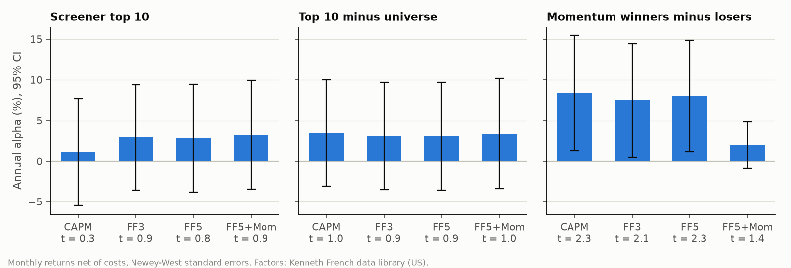

# Factor regressions: alpha, or just factor exposure?

October 2026. The screener's top 10 beat its universe by 3.2% a year in the backtest (t ≈ 1). The standard question in asset management is whether that is skill or just exposure to known factors, so I regressed my backtested portfolios on the Fama-French factors.



## Setup (`factor_regressions.py`)

- Portfolios. These are the monthly returns from my own backtests, in dollars and net of costs:
  - From the screener's point-in-time backtest (`inputs/sleeves.csv`, Feb 2012 – Aug 2026): the top 10, the equal-weight universe and the MSCI-style quality quintile.
  - From the [momentum project](../momentum) (Feb 2013 – Aug 2026): the 12-1 winners quintile and winners-minus-losers.
- Factors. US monthly factors from Kenneth French's data library: market, size (SMB), value (HML), profitability (RMW), investment (CMA) and momentum. The script downloads them on first run; they aren't redistributed here.
- Models. CAPM, FF3, FF5 and FF5 + momentum. OLS with Newey-West standard errors (3 lags). Long-only portfolios are regressed in excess of the T-bill; long-short ones are already excess returns.

## Results

| Portfolio | CAPM α | FF5 + Mom α | Mkt | SMB | HML | RMW | CMA | Mom | R² |
|---|---|---|---|---|---|---|---|---|---|
| Screener top 10 | +1.1% (t 0.3) | +3.2% (t 0.9) | 0.95 | 0.64 | 0.28 | **0.68** | −0.37 | −0.07 | 0.69 |
| Top 10 minus universe | +3.5% (t 1.0) | +3.4% (t 1.0) | −0.07 | 0.10 | 0.26 | **0.68** | −0.45 | −0.06 | 0.21 |
| Equal-weight universe | −2.4% (t −1.5) | −0.2% (t −0.3) | 1.03 | 0.54 | 0.02 | 0.00 | 0.08 | −0.01 | 0.97 |
| Quality quintile | −0.8% (t −0.6) | +0.3% (t 0.2) | 0.95 | 0.47 | −0.06 | 0.30 | −0.02 | 0.05 | 0.91 |
| Momentum winners (Q5) | −1.1% (t −0.4) | −0.7% (t −0.7) | 1.19 | 0.65 | −0.05 | −0.31 | 0.13 | 0.49 | 0.95 |
| Momentum winners − losers | **+8.4% (t 2.3)** | +2.0% (t 1.4) | 0.08 | 0.02 | −0.03 | −0.21 | 0.14 | **1.11** | 0.89 |

Full table with every model and t-statistic: `results/factor_regressions.csv`.

## Reading the loadings

The screener is a profitability tilt, plus small-cap value. Relative to its universe, the top 10's clearest exposure is RMW (0.68): it buys highly profitable companies, which isn't surprising for a screen that puts 30% of the weight on ROE. It also leans towards value (HML 0.26) and towards companies that invest aggressively (CMA −0.45). After all that, the leftover alpha is still ~3% a year, but with t ≈ 1. That's the same conclusion as the original backtest from a different angle: possibly something, not proven.

The CAPM alone is misleading here. The equal-weight universe has a −2.4% CAPM alpha simply because small caps lagged large caps in 2012–26. Add the size factor and it disappears (R² 0.97). The top 10's CAPM alpha (+1.1%) looks worse than its FF5 alpha (+2.8%) for the same reason. Judged against SPY alone, my screener looks worse than it is; judged against its own universe it looks better than the market comparison suggests.

My momentum backtest is the momentum factor, which is a good check on the code. French's momentum factor explains 89% of my winners-minus-losers series, with a loading of 1.1. Both even show the same crash in July 2026. The CAPM and FF5 alphas look significant (t 2.3), but only because momentum moved against the market in this period (beta −0.2) and the five factors don't include momentum. Once it's in the model, the alpha drops to 2% with t 1.4. That's a known, published premium, not something I discovered.

Quality behaves like the market with a bit of profitability. That matches the earlier finding that the quality quintile was about equal to its universe.

## Caveats

- The universes are survivors. Built from today's listings, so all the alphas are probably biased up a little.
- Factor portfolios aren't free to trade. French's factors are value-weighted long-short portfolios with no costs, while my portfolios pay costs. That biases my alphas slightly down.
- The sample is short. 14 years is enough to estimate loadings well, but not alphas of 2–3% a year. With these volatilities, a real 3% alpha would need several decades of data to reach t = 2.

```
cd research/factor-models
python factor_regressions.py
```
