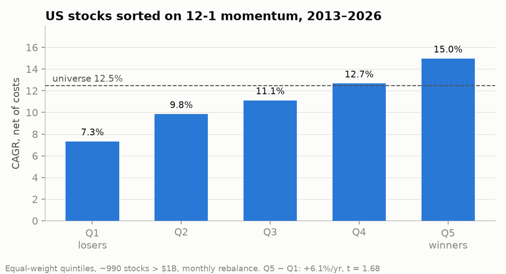

# Cross-sectional momentum

October 2026. 12-1 momentum (buy what went up most over the last year, skipping the last month) is probably the best-documented equity factor. I had already seen sector momentum fail in my [sector TAA test](../../strategy-lab/taa_sectorial), so here I try it on single stocks and on country ETFs.

## US stocks (`xs_momentum_us.py`, `robustness.py`)

I reuse the universe from the [screener backtest](../../equity-screener): stocks above $1B of market cap at each month end, about 990 on average, 2013–2026. Each month I sort them on the signal into equal-weight quintiles, with 10 bp per side on turnover. t-stats are Newey-West with 3 lags.

One important caveat: the universe is built from companies listed today. The ones that went bust are missing, so the losers look better than they really were and the true winners-minus-losers spread is probably somewhat larger. The winners, which is what I'd actually buy, are less affected.

| Signal | Losers | Winners | Universe | Win − lose | t | Win − univ | t |
|---|---|---|---|---|---|---|---|
| 12-1 | 7.3% | 15.0% | 12.5% | +6.1% | 1.68 | +2.7% | 1.37 |
| 6-1 | 8.2% | 13.4% | 12.5% | +4.5% | 1.33 | +1.3% | 0.70 |
| 3-1 | 9.8% | 11.9% | 12.5% | +1.6% | 0.44 | −0.1% | −0.05 |
| 12-1 / vol | 6.4% | 14.5% | 12.5% | +6.5% | 1.78 | +1.8% | 0.97 |
| 12-1 sector-neutral | 9.0% | 14.4% | 12.5% | +4.3% | 1.42 | +2.0% | 1.12 |
| Sector only | 7.9% | 14.3% | 12.5% | +5.4% | 1.44 | +1.7% | 0.83 |

The shape is the textbook one: with 12-1 the five quintiles line up in order. But no version reaches t = 2, and splitting the sample shows most of it comes at the end: about +3% a year in 2012–16 and 2017–21, then +11% in 2022–26. The worst month for the long-short was July 2026, at −19.8%.

Holding only the winners' quintile gives 15.0% a year against 14.7% for SPY over the same period, but with 20% volatility instead of about 15% and roughly 28% of the portfolio turned over every month. With ~200 names that's about 1,300 trades a year, and in Spain every sale at a gain is taxed.

## Country and sector ETFs (`etf_momentum.py`)

For a long sample with no survivorship bias I ran the same idea on 20 iShares country ETFs (plus SPY) and the 9 SPDR sector ETFs, 1999–2026: buy the top 5 countries or top 3 sectors and compare with all of them at equal weight.

| Set | Top − average | t |
|---|---|---|
| Countries 12-1 | +0.3%/yr | 0.23 |
| Countries 6-1 | −0.1% | −0.06 |
| Sectors 12-1 | +0.2% | 0.18 |
| Sectors 6-1 | −1.3% | −0.96 |

Nothing in 27 years, which matches what I saw in the TAA test.

## What I take from it

In single stocks the effect seems to be there, but it's weak, recent and expensive to capture. In ETFs there is nothing. I won't run it as a strategy. The one thing left to try is using it as a filter in the screener, e.g. dropping names in the bottom 12-1 quintile.

A side result that fed into the mean-reversion project: one-month reversal in this same universe comes out at roughly zero (t = 0.2).

To reproduce: build the screener backtest caches first (`python run_backtest.py` in `equity-screener/`), then run the scripts here.
