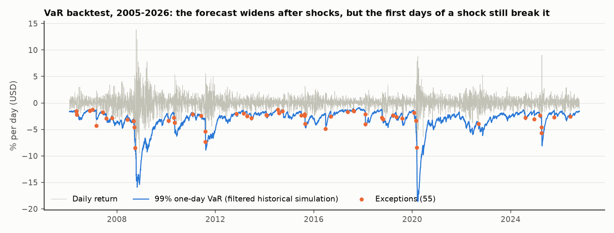
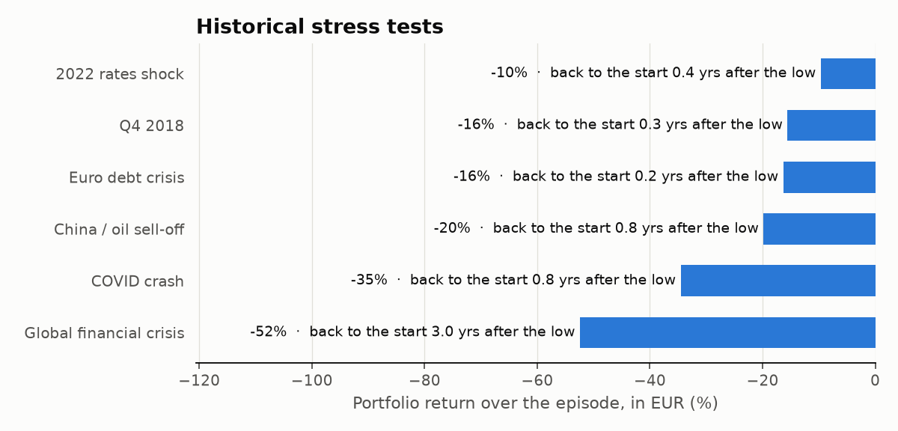

# Portfolio risk: VaR, CVaR, a VaR backtest and stress tests

October 2026. The structure I aim for is a simple 70/20/10: a global index core, a value sleeve fed by the screener and a small tactical part. I wanted to measure its risk the way a risk desk would, and in particular to see which VaR methods actually hold up when you backtest them.

## The portfolio (`portfolio_risk.py`)

I used liquid ETFs with daily history from 2004, so the sample includes 2008, 2011, 2020 and 2022:

| Sleeve | Weight | Proxy |
|---|---|---|
| Global core | 70% | 42% SPY + 21% EFA + 7% EEM (roughly ACWI's US / developed / emerging split) |
| Value sleeve | 20% | IJS, S&P 600 small-cap value. The [factor regression](../factor-models) showed my screener is a small, value, high-profitability tilt |
| Tactical | 10% | RSP, S&P 500 equal weight |

One data issue I had to fix first. I started in euros, converting with Yahoo's EURUSD rate. Daily volatility came out at 21%, but weekly data implied 17%. The FX close and the NYSE close are hours apart, and that mismatch adds noise every day. So daily VaR and its backtest are in **dollars**, the currency the ETFs trade in. The stress tests run over weeks or months, where the timing doesn't matter, so those are shown in euros and dollars.

The sample has 5,527 days, an annualised volatility of 19.7% and **excess kurtosis of 13**: fat tails, which turn out to matter for everything below.

## One-day VaR and CVaR, five ways

Loss as a percentage of the portfolio, full sample:

| Method | VaR 95% | CVaR 95% | VaR 99% | CVaR 99% |
|---|---|---|---|---|
| Historical | 1.78 | 2.97 | 3.39 | 5.28 |
| Normal | 1.99 | 2.51 | 2.83 | 3.25 |
| Cornish-Fisher (skew/kurtosis adjusted) | 1.70 | – | 6.69 | – |
| EWMA, today (RiskMetrics λ = 0.94) | 1.03 | 1.30 | 1.46 | 1.68 |
| Monte Carlo, multivariate Student-t (5 d.o.f.) | 1.87 | 2.73 | 3.23 | 4.23 |

- The normal distribution gets the tail wrong. It's fine at 95%, but at 99% it understates the expected loss beyond VaR (CVaR) by about 40% against history: 3.3% against 5.3%.
- Cornish-Fisher overshoots. With kurtosis this high the expansion stops being reliable, and it doubles the 99% VaR.
- The Student-t Monte Carlo lands closest to history. It's the parametric method that does best.
- EWMA reflects today's calm market: 1.5% at 99%, against 3.4% over the full history. It answers a different question: risk *now*, not on average.

## Backtesting the 99% VaR, 2005–2026

Each day I forecast the next day's VaR using only past data, then count how often the actual loss was bigger. Two tests:

- Kupiec: are there too many exceptions?
- Christoffersen: do exceptions come in clusters?

| Method | Exceptions | Expected | Kupiec p | Christoffersen p | Exceptions on consecutive days |
|---|---|---|---|---|---|
| Normal, 1-year window | 138 | 53 | 0.000 | 0.000 | 16 |
| EWMA (RiskMetrics) | 117 | 53 | 0.000 | 0.063 | 6 |
| Historical, 1-year window | 90 | 53 | 0.000 | 0.000 | 8 |
| **Filtered historical simulation** | **55** | **50** | **0.51** | 0.003 | 4 |



- Three of the four methods fail outright. The normal model breaks the 99% VaR 2.6% of the time instead of 1%. That's the fat-tail problem in one number.
- **Filtered historical simulation** gets the count right. It rescales each past return by the volatility of its day, then applies today's EWMA volatility, so it combines a reactive volatility with the real shape of the tails.
- Even FHS fails the independence test. Exceptions still bunch together at the start of each crisis: 2008, August 2011, March 2020, April 2025. A model fed only on past returns can't anticipate the first days of a shock. That's what stress tests are for.

## Historical stress tests

| Episode | Portfolio in EUR | Portfolio in USD | Back to the starting level |
|---|---|---|---|
| Global financial crisis (Oct 2007 – Mar 2009) | −52% | −54% | 3.0 years after the low |
| COVID crash (Feb – Mar 2020) | −35% | −35% | 0.8 years |
| China / oil sell-off (Jul 2015 – Feb 2016) | −20% | −17% | 0.8 years |
| Euro debt crisis (Jul – Oct 2011) | −16% | −21% | 0.2 years |
| Q4 2018 | −16% | −18% | 0.3 years |
| 2022 rates shock (Jan – Oct 2022) | **−10%** | **−21%** | 0.4 years |



- For a euro investor, the dollar has been a shock absorber. In 2022 it halved the loss (−10% vs −21%) as the dollar rallied. It helped in 2011 and 2018 too. The exception was 2015–16, when the euro was rising. That cushion is a reason not to hedge the currency on an equity portfolio.
- The value sleeve is not a defence. It fell more than the core in 2008, 2011 and especially COVID (IJS −42% in euros, against −33% for SPY). It only helped in 2022, when value beat growth.
- 2008 is the real test. −52% and three years to recover from the low. Everything else in the sample recovered within a year.

## Where the risk comes from

| Sleeve | Weight | Share of portfolio volatility |
|---|---|---|
| Global core | 70% | 68% |
| Value sleeve | 20% | 22% |
| Tactical | 10% | 10% |

Risk shares almost equal the weights. Everything is equity and highly correlated, so splitting it into sleeves adds no real diversification. Only a different asset would change that: bonds, or the trend sleeve I tested in [portfolio construction](../../strategy-lab/portfolio_construction).

```
cd research/portfolio-risk
python portfolio_risk.py      # downloads prices on the first run (data/, not committed)
```
