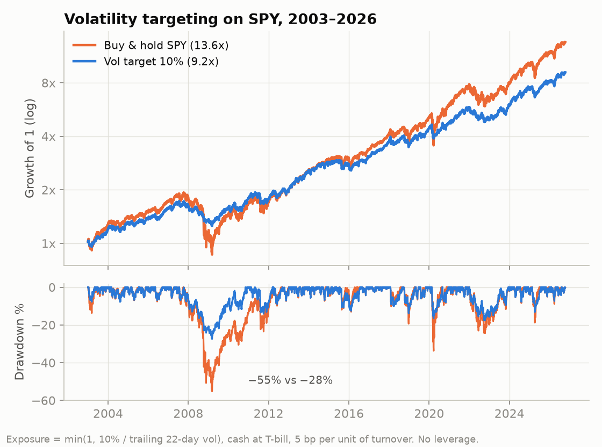

# Realised volatility: forecasting it, and using it to size exposure

October 2026. I wanted to know two things: whether a HAR model forecasts volatility better than just looking at the last few weeks, and whether a better forecast helps when you scale equity exposure to hit a volatility target.

## Step 1: SPY (`har_voltarget.py`)

Daily SPY from 1993, evaluated from 2003. I don't have intraday data, so daily variance comes from the high–low range (Parkinson). HAR is refitted every year on the data available up to that point, with a 42-day gap so training and test never overlap. I compare it with two simple alternatives: trailing 22-day volatility and an EWMA.

For the volatility of the next 21 days, HAR wins clearly:

| Model | RMSE | QLIKE | Correlation |
|---|---|---|---|
| HAR | 0.054 | 0.283 | 0.74 |
| Trailing 22 days | 0.061 | 0.362 | 0.70 |
| EWMA | 0.078 | 0.320 | 0.69 |

Then I use each forecast for volatility targeting: exposure = min(1, 10% / forecast vol), no leverage, cash earning the T-bill and 5 bp for every unit of exposure change.

| 2003–2026 | Return | Vol | Sharpe* | Max DD |
|---|---|---|---|---|
| Buy and hold | 12.7% | 18.5% | 0.69 | −55% |
| 84% SPY fixed + cash | 10.8% | 15.5% | 0.70 | −48% |
| Vol target with HAR | 9.8% | 11.6% | 0.85 | −30% |
| Vol target with trailing 22d | 9.9% | 11.5% | 0.86 | −28% |
| Vol target with EWMA | 8.4% | 10.0% | 0.84 | −23% |

*Not excess of the risk-free rate; only for comparing rows.

The interesting part is that the better forecast doesn't show up in the strategy. The trailing 22-day version does as well as HAR and trades a third as much. Volatility targeting itself does change the profile: the maximum drawdown goes from −55% to −30%, at the cost of about 3 points of return a year. Against holding 84% fixed (the same average exposure), the Sharpe improves by about 0.15. The block-bootstrap CI for that gain runs from −0.01 to 0.30, so close, but not quite.

## Step 2: a global ETF (`vwrl_voltarget.py`)

I repeated it on VWRL.AS, the FTSE All-World ETF I hold as my core position, to see whether it holds up. First I hit a data problem: Yahoo has bad VWRL.AS prints in June 2013 (single days of +25% and +32%), which pushed measured volatility to an absurd 19%. I start in 2014 instead, and use ACWI in dollars for a sample that includes 2008.

This time the rule is one I could actually follow by hand: check once a week and only trade if target exposure moves more than 10 points. That's 3–5 trades a year, with 10 bp of costs.

| Sample | Strategy | CAGR | Vol | Max DD | Worst year |
|---|---|---|---|---|---|
| VWRL.AS 2014– | Buy and hold | 12.4% | 15.4% | −33% | −13.6% |
| | 94% fixed | 11.6% | 14.4% | −32% | −12.8% |
| | Target 12%, weekly | 10.5% | 13.5% | −25% | −14.4% |
| ACWI 2008– | Buy and hold | 8.2% | 20.1% | −56% | −38.9% |
| | 90% fixed | 7.6% | 18.1% | −52% | −35.4% |
| | Target 12%, weekly | 7.7% | 14.3% | −30% | −20.7% |

On VWRL since 2014 it adds nothing: return per unit of risk is the same as holding 94% fixed, and the worst calendar year is actually worse. That makes sense, because the sell-offs since 2014 have been fast and V-shaped (2020, 2025): the signal sells after the fall and buys back late. With ACWI from 2008 the picture changes and the drawdown nearly halves, but that is basically 2008.

On top of that, every cut in exposure means selling and realising gains, which I didn't model.

So I won't run it systematically. I see it as insurance against slow bear markets like 2008, similar to what I found with trend following.

Not done: a GARCH benchmark, and the variance risk premium (VIX against realised vol).
