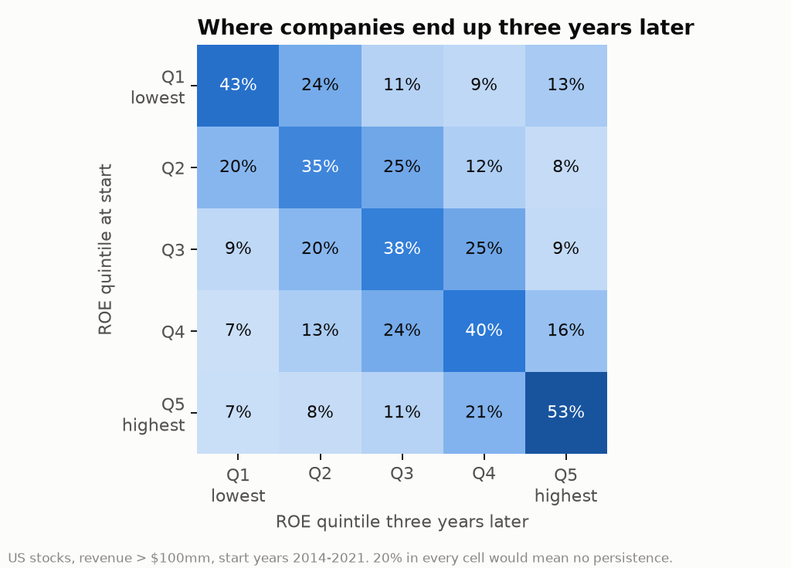

# SQL on SEC filings: five questions about US companies

October 2026. I had 1.4 GB of SEC XBRL data on disk from the screener backtest: every number every US-listed company has tagged in its filings. I wanted to practise SQL on real, messy financial data, so I loaded it into DuckDB and asked it some questions I was curious about.

## Setup

- `build_db.py` reads the SEC's `companyfacts.zip` (20,438 filers) and keeps 16 key us-gaap tags (revenue, operating and net income, equity, assets, cash flow items, buybacks, dividends, diluted shares). It keeps **every version** of each number, with the date it was filed. That gives 10.4 million rows, plus sector labels and monthly prices for ~2,600 US stocks from the screener backtest. It takes about 10 minutes and produces a ~350 MB `sec.duckdb`, which isn't in the repo.
- `queries/*.sql`: one file per question, each with a comment explaining it.
- `run_queries.py` runs them in order and writes `results/*.csv` and [`results/RESULTS.md`](results/RESULTS.md).

```
pip install -r requirements.txt
python build_db.py --data ../equity-screener/data
python run_queries.py
```

**[`01_annual_financials.sql`](queries/01_annual_financials.sql)** does the heavy lifting. The same annual figure appears in several filings: the original 10-K, next year's 10-K as a comparative, sometimes an amendment. So the first step uses `ROW_NUMBER()` windows to keep the first and latest value filed for each company, tag and year. Then conditional aggregation pivots the tags into an income-statement-style table. Revenue alone has three common tags depending on the year and the filer, which is why it uses `COALESCE`.

## 1. Which sectors have the highest and most cyclical margins? ([02](queries/02_sector_margins.sql))

Median operating margin by sector each year, 2012–2025 (companies with revenue above $100mm, financials excluded):

| Sector | Typical margin | Worst year | Best year | Cyclicality* |
|---|---|---|---|---|
| Utilities | 18.4% | 16.8% (2012) | 21.7% (2025) | 0.016 |
| Consumer non-durables | 11.7% | 8.0% (2025) | 13.7% (2013) | 0.015 |
| Energy minerals | 10.5% | −49.5% (2020) | 38.5% (2022) | **0.250** |
| Producer manufacturing | 9.9% | 8.9% (2015) | 11.6% (2024) | **0.008** |
| Technology services | 4.0% | −3.8% (2022) | 11.0% (2013) | 0.043 |
| Distribution services | 3.2% | 2.7% (2015) | 5.6% (2022) | 0.008 |

*Standard deviation of the yearly sector median. The full table has 18 sectors.

Energy is in a league of its own: the median oil and gas company went from −50% to +39% in two years. The "technology services" median is low because the sector is full of unprofitable software companies. The median hides the giants.

## 2. How often do companies change an annual number after filing it? ([03](queries/03_restatements.sql))

I compared the first value reported for each fiscal year with the latest value filed for that same year:

| Fiscal year | Revenue revised > 1% | of which down | Net income revised > 1% |
|---|---|---|---|
| 2012 | 15.5% | 14.1% | 5.5% |
| 2015 | 9.6% | 7.8% | 5.3% |
| 2018 | 8.7% | 7.1% | 5.0% |
| 2021 | 6.5% | 5.6% | 4.9% |
| 2023 | 7.1% | 6.2% | 4.1% |

In recent years about one company in 14 has re-presented a past year's revenue (one in 6 back in 2012), almost always **downwards**. Fraud isn't the explanation: when a company sells or discontinues a business, it re-presents past revenue without it. When it happens, the median change in recent years is 16–19%. Net income revisions are rarer (~5%) and roughly symmetric.

This is why the screener backtest uses first-reported numbers. A backtest on "latest" values quietly knows about divestitures that hadn't happened yet.

I had a bug here worth admitting. Companies sometimes report revenue under two tags in the same year, so my first version double-counted about 10% of rows. The fix (a `ROW_NUMBER()` over the tag preference) barely moved the percentages, but it's the kind of thing that does move a different question.

## 3. Did companies that shrank their share count outperform? ([04](queries/04_buybacks_and_returns.sql))

I sorted stocks by the change in diluted shares between FY2015 and FY2020, then looked at their total return from January 2021 to December 2025:

| Quintile | Median share change 2015–20 | Median return 2021–25 | Mean return | Share with a loss |
|---|---|---|---|---|
| 1 (most shrinkage) | −17% | **+55%** | +91% | 30% |
| 2 | −6% | +27% | +75% | 34% |
| 3 | +1% | +22% | +56% | 38% |
| 4 | +9% | +35% | +76% | 32% |
| 5 (most dilution) | +52% | +23% | +90% | 43% |

The typical buyback company did much better (median +55% against +22–35%) and lost money less often. The *means* of the two extreme quintiles are almost identical, though: the heavy diluters include a few huge winners (fast growers that issue stock) and a lot of losers. That makes sense, and it's a good example of why I look at medians and means together.

Two caveats. The universe only has companies still listed today, so the worst diluters that went bust are missing. And 2021–25 is one five-year window, so this describes what happened, not a strategy.

## 4. Do high-ROE companies stay high-ROE? ([05](queries/05_roe_persistence.sql))

Each year from 2014 to 2021, I ranked companies into ROE quintiles with `NTILE(5)`, then self-joined each company to its own row three years later:



The diagonal is strong. 53% of top-quintile companies are still top-quintile three years later, against 20% if ROE were random, and only 7% fall to the bottom. That persistence is the reason quality investing makes sense. In my earlier [quality factor backtest](../SYNTHESIS.md) it still didn't translate into excess returns, presumably because the market prices it in.

The 13% that jump from the bottom quintile to the top are mostly turnarounds, plus companies whose small equity base inflates ROE.

## 5. How fast do companies file their 10-K? ([06](queries/06_filing_lag.sql))

Days from fiscal year end to the first 10-K, 2012–2025:

| Total assets | Filings | Median days | 90th percentile | Filed after 90 days |
|---|---|---|---|---|
| > $10bn | 8,409 | 54 | 60 | 0.3% |
| $1–10bn | 20,782 | 58 | 75 | 1.1% |
| $100mm–1bn | 19,643 | 70 | 90 | 6.1% |
| < $100mm | 28,227 | 90 | 117 | 41% |

The tiers match the SEC deadlines (60, 75 and 90 days). Big companies file a week early, while 41% of the smallest file after 90 days, which usually means they asked for an extension. For a backtest, this is why fundamentals need a "known on" date: a December year-end small cap's numbers often aren't public until April.

## SQL used

- CTEs throughout.
- Window functions: `ROW_NUMBER`, `NTILE` and partitioned ranking.
- Conditional aggregation to pivot tags into columns.
- `COALESCE` across alternative tags.
- Self-joins across years.
- Aggregates: `MEDIAN`, `QUANTILE_CONT`, `STDDEV_SAMP` and DuckDB's `arg_min` / `arg_max`.
- `date_diff`.
