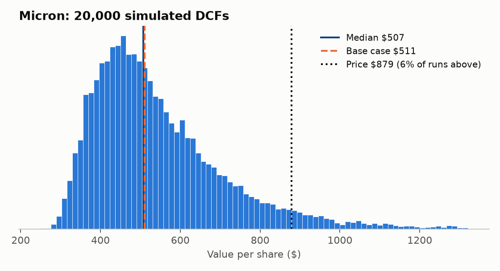
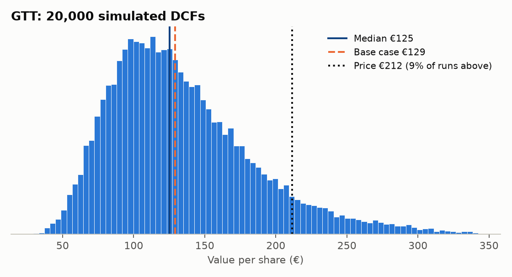
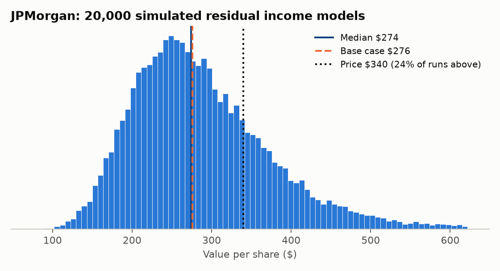

# Valuation models

| Folder / file | What it is |
|---|---|
| [`micron/`](micron) | Three-scenario DCF of Micron at the top of a memory cycle (Excel, built from SEC XBRL data) |
| [`jpm/`](jpm) | Residual income model of JPMorgan with three ROTE scenarios, the implied ROTE and peers (Excel, built from SEC data and the Q3 2026 release) |
| [`gtt/`](gtt) | Three-scenario DCF of GTT, driven by its order book and royalties per ship (Excel, built from company press releases) |
| `models.py` | The same three models in Python, used by the dashboard and the Monte Carlo |
| `test_models.py` | Checks that `models.py` gives exactly the Excel values with the default inputs |
| `monte_carlo.py` | 20,000 simulated DCFs per company instead of three scenarios |

## Monte Carlo: from three scenarios to a distribution

Three scenarios hide two things: how likely each one is, and what happens in between. So I drew 20,000 sets of assumptions for each company and ran the same DCF on every one. Distributions are centred on my base case and documented in `monte_carlo.py`.

**Micron.**
- Revenue: FY27–28 growth is drawn around consensus.
- Cycle depth: how far revenue falls back by FY31 is lognormal around the base case, roughly −53% from FY28. The 5–95% range runs from a deep bust to no downturn at all.
- Normalised margin: centred on 35% and **correlated (0.6) with revenue**. In memory, prices drive both, so a mild downturn and decent margins tend to come together.
- Capex: follows revenue only partly, because fabs are committed years ahead.
- Discount rate: WACC ±1.5 pp. Terminal growth 2–4%.

**GTT.**
- Orders: the average LNG-carrier-equivalent orders a year for 2027–35 are lognormal around the company's own ~60, with a 5–95% range of about 37–98. Each year then varies around that average, because orders are lumpy.
- Royalty per ship: €9.5mm ± €0.75mm.
- Other inputs: WACC ±1 pp, terminal growth 0–2.5%, and GTT Marine growth of 3–12%.

| | Price | Base-case DCF | 5th pct | Median | 95th pct | Runs above the price | Main driver (rank correlation) |
|---|---|---|---|---|---|---|---|
| Micron | $879 | $511 | $348 | $507 | $895 | **5.5%** | Depth of the downturn (+0.82), then normalised margin (+0.76) |
| GTT | €212 | €129 | €68 | €125 | €238 | **8.7%** | Average orders a year (+0.81), then WACC (−0.25) |
| JPM | $340 | $276 | $170 | $274 | $458 | **23.9%** | Long-run ROTE (+0.72), then cost of equity (−0.60) |





For JPM the long-run ROTE is drawn around management's 17% target (±2.5 pp), with a 30% chance of a credit cycle that drops ROTE to 8–14% in years 2–3.

### So what

- **The medians land on the base cases** ($507 vs $511, €125 vs €129). That's a check that the distributions are centred where I meant them to be, not a finding.
- "Expensive" survives the uncertainty for Micron and GTT: only about one simulated world in 18 (Micron) or 11 (GTT) is worth more than today's price. JPM is different. One run in four beats the price, which fits "quality at a full price" rather than "expensive".
- The answer depends on how wide you think the uncertainty is. With the key distributions 50% wider, those shares rise to 13% and 16%. Fatter tails put more weight on the good outcomes the market is paying for.
- This also exposed an inconsistency in my own work. In the scenario version I gave Micron's bull case a 20% probability. In the Monte Carlo, outcomes that good come up only ~5% of the time. One of the two is too generous, and I'd rather point that out than hide it. Either way, the stock comes out expensive.
- The ranking of drivers matches the qualitative thesis. For Micron it's how deep the cycle turns, not the discount rate. For GTT it's how many ships get ordered. Nothing else comes close.

```
cd valuation
python -m unittest test_models -v   # Python models == Excel
python monte_carlo.py               # ~5 seconds; writes results/ and figures/
```
